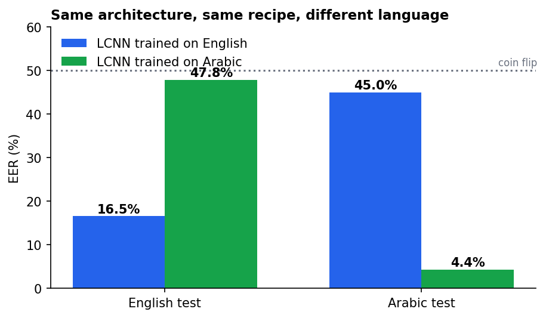
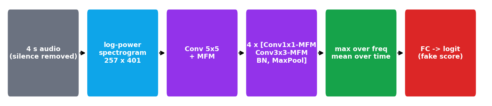
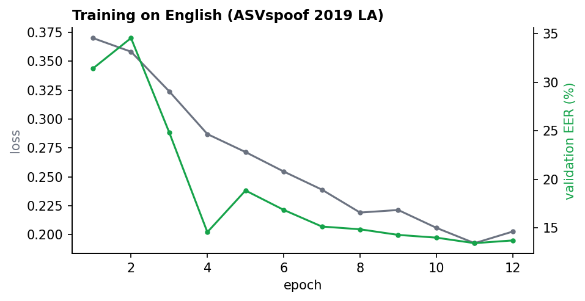
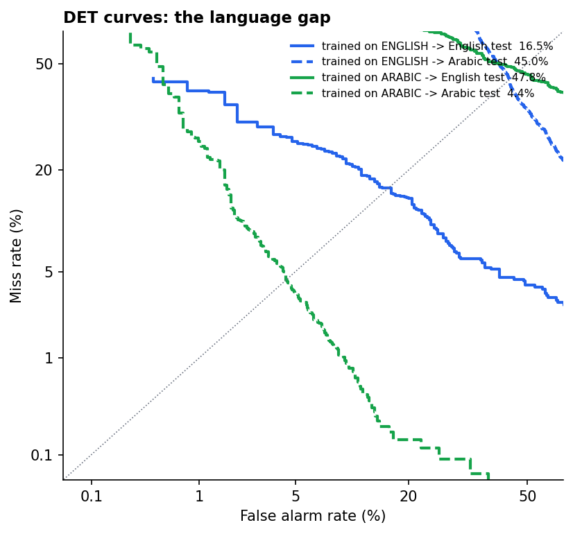
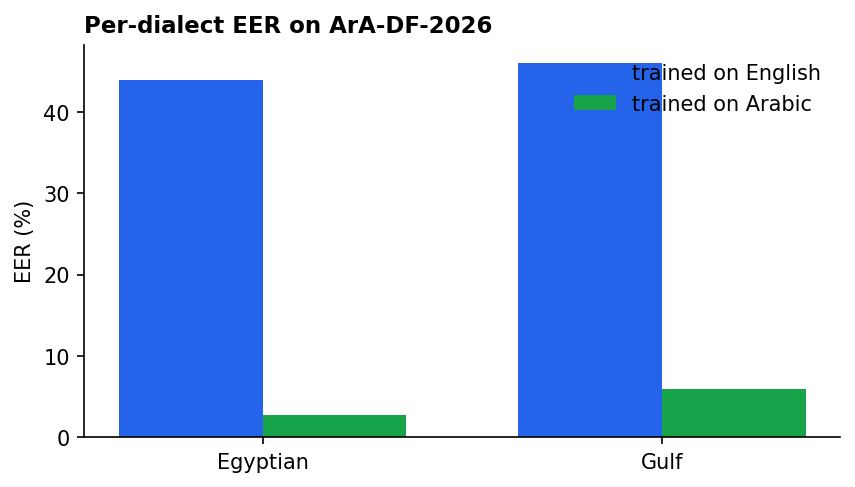
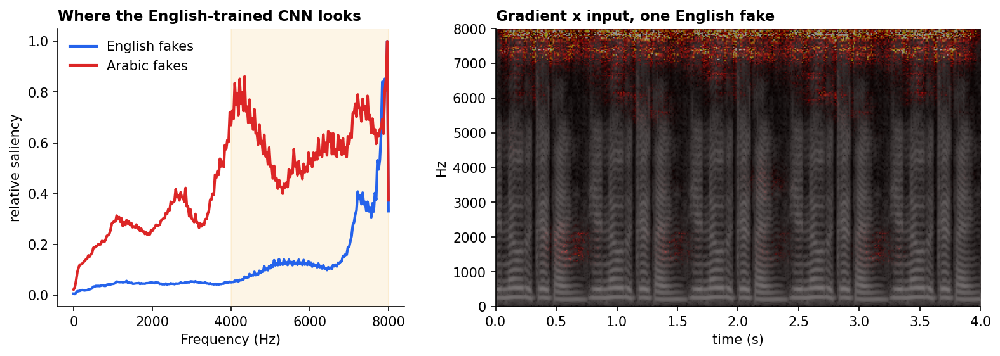
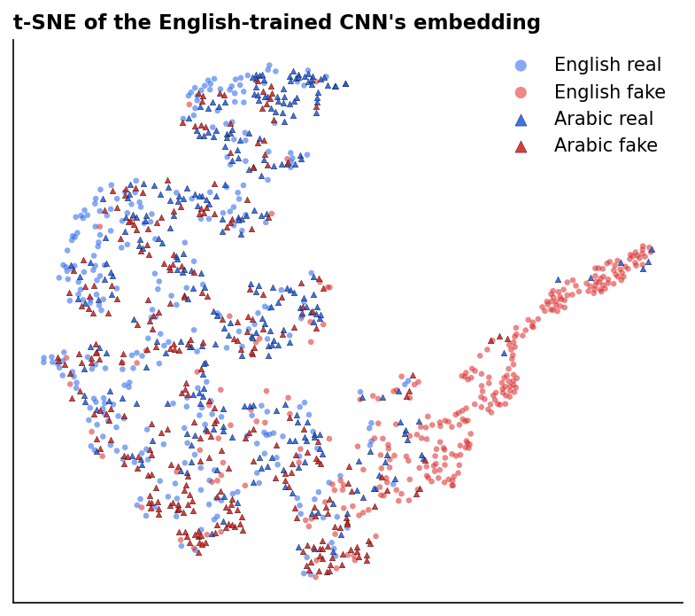
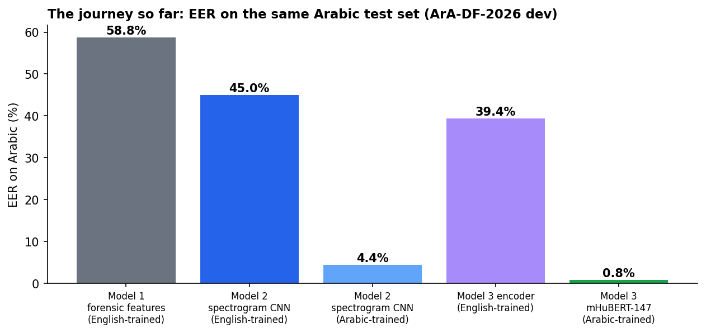

<div align="center">

# QDF-02 · Spectrogram LCNN for Deepfake Voice Detection

**A 160 k-parameter Light CNN that learns deepfake fingerprints directly from the spectrogram. Trained on English it reaches 45 % EER on Arabic. Trained on Arabic, the same network reaches 4.4 %.**


Model 2 of 5 in the **QDF research series** by **Evan Deep**

[Motivation](#1-motivation) · [Method](#2-method) · [Results](#3-results) · [What the CNN looks at](#4-what-the-cnn-looks-at) · [Limits](#5-limits--next-step) · [Reproduce](#6-reproduce)

</div>

---

## TL;DR

| Trained on ↓ / tested on → | English (ASVspoof 2019 LA, unseen speakers) | Arabic (ArA-DF-2026 dev) | ↳ Egyptian | ↳ Gulf |
|---|---:|---:|---:|---:|
| **English** | 16.5 % (AUC 0.92) | **45.0 %** (AUC 0.57) | 43.9 % | 46.0 % |
| **Arabic** (ArA-DF train) | 47.8 % (AUC 0.54) | **4.4 %** (AUC 0.99) | 2.8 % | 5.9 % |

<p align="center"></p>

Same architecture, same recipe, same preprocessing. Only the training language changes, and the error on the other language goes to near chance **in both directions**.

---

## 1. Motivation

Model 1 used 136 hand-crafted forensic features and found that they **invert** between English and Arabic (58.8 % EER on Arabic). Hand-crafted features encode human assumptions about what a fake sounds like. The obvious next question: **if a network learns the evidence from the spectrogram on its own, does it learn something more universal?**

The LCNN is a natural choice: it won ASVspoof 2017 and has been the standard ASVspoof baseline since 2019. Its Max-Feature-Map activation keeps the stronger of two competing feature maps, which suits evidence that consists of small, local spectral artefacts.

## 2. Method

<p align="center"></p>

| Step | Detail |
|---|---|
| Input | 16 kHz, **silence trimmed** (Model 1's "silence trap"), peak-normalised, 4 s crop (shorter files tiled) |
| Front-end | STFT 512 / hop 160 / Hann 400 → **linear-frequency** log-power spectrogram, 257 × 401, per-utterance normalisation. Linear rather than mel, because mel compresses the 4–8 kHz band where Model 1 found vocoder evidence |
| Network | Conv 5×5 + MFM → 4 × [Conv 1×1 + MFM, Conv 3×3 + MFM, BatchNorm, MaxPool] → max over frequency, mean over time → FC 32-64-1. **160 k parameters** |
| Augmentation | random circular time shift, random gain 0.3–1.0, faint noise floor (−90 to −50 dB) |
| Training | BCE with class weighting, AdamW lr 3·10⁻⁴, OneCycle, batch 16, 12 epochs, best epoch on a 10 % validation split. Apple M3 (MPS): ~85 s/epoch English, ~290 s/epoch Arabic |
| English split | speaker-disjoint 70 / 30, **identical** to Model 1 (same seed, same speakers) |

<p align="center"></p>

## 3. Results

### 3.1 English → Arabic
<p align="center"></p>

* **English test: 16.5 % EER.** Similar to Model 1's 16.8 % on the same speakers. Published LCNN results on ASVspoof 2019 LA are much lower, but they keep the leading and trailing silence. With silence removed, a large part of that easy signal is gone (see Model 1, "silence trap").
* **Arabic test: 45.0 %**, AUC 0.57. Better than Model 1 (58.8 %), because the CNN no longer **inverts**, but still close to guessing.

Per ASVspoof attack (English-trained, English test): A07, A08, A16, A19 at 0 %; hardest are **A13 (36.6 %)**, **A17 (31.6 %)**, A12 (25.2 %), A10 (17.2 %). A17 is a VAE voice-conversion system and A13 combines TTS and VC with waveform filtering, so they leave the fewest vocoder artefacts.

### 3.2 Training on Arabic
<p align="center"></p>

The same network trained on 7 499 ArA-DF train files (Egyptian, Gulf, MSA) reaches **4.4 %** on ArA-DF dev. Gulf (5.9 %) is harder than Egyptian (2.8 %), the same ordering Model 3 later finds.

## 4. What the CNN looks at

<p align="center"></p>

Gradient × input saliency, averaged over 96 fake files per language, for the **English-trained** network:

* On **English fakes**, almost all saliency sits **above 7 kHz**: the network learned the top-band signature of the ASVspoof 2019 vocoders.
* On **Arabic fakes**, saliency is spread over the whole band. The network searches for its familiar top-band fingerprint, does not find it, and has nothing else to go on.

<p align="center"></p>

t-SNE of the penultimate embedding: **English fakes** form their own branch, while **Arabic fakes fall among the real speech**. For an English-trained CNN, an Arabic deepfake simply looks like a real voice.

## 5. Limits & next step

| Observation | Consequence |
|---|---|
| A from-scratch CNN trained on Arabic reaches 4.4 % | Arabic training data is necessary, **but** 7.5 k files are not enough to learn speech from scratch |
| The network relies on narrow high-frequency bands | fragile under codecs and phone lines, which cut exactly those bands |
| Gulf is the hardest dialect | Gulf data must be in training |

**Model 3** keeps the Arabic training data but replaces the from-scratch CNN with a **frozen multilingual speech encoder (mHuBERT-147)**. Error on the same Arabic test set: **4.4 % → 0.77 %**.

<p align="center"></p>

## 6. Reproduce

```bash
pip install -r requirements.txt
python scripts/01_build_cache.py --corpus asvspoof        # silence-trimmed 4 s crops → ../data/cache
python scripts/01_build_cache.py --corpus aradf_train
python scripts/01_build_cache.py --corpus aradf_dev
python scripts/02_train.py --train asvspoof               # English-trained, ~17 min on Apple M3
python scripts/02_train.py --train aradf_train            # Arabic-trained,  ~60 min on Apple M3
python scripts/03_make_figures.py
```
On a 16 GB Apple-silicon machine, cap the MPS allocator so training does not push the system into swap:
`export PYTORCH_MPS_HIGH_WATERMARK_RATIO=0.4 PYTORCH_MPS_LOW_WATERMARK_RATIO=0.3`

```
qdf-02-spectrogram-lcnn/
├── src/spec_lcnn/
│   ├── model.py      # Spectrogram front-end, MFM, LCNN
│   ├── data.py       # ASVspoof / ArA-DF readers, silence trimming
│   └── metrics.py    # EER, AUC
├── scripts/          # 01 cache → 02 train/eval → 03 figures
├── results/          # metrics_{en,ar}.json, scores_*.csv, models/lcnn_{en,ar}.pt
└── assets/figures/
```

## References

1. G. Lavrentyeva et al., *Audio Replay Attack Detection with Deep Learning Frameworks*, Interspeech 2017 (LCNN, ASVspoof 2017 winner).
2. G. Lavrentyeva et al., *STC Antispoofing Systems for the ASVspoof2019 Challenge*, Interspeech 2019.
3. X. Wu et al., *A Light CNN for Deep Face Representation with Noisy Labels*, IEEE TIFS 2018 (Max-Feature-Map).
4. X. Wang et al., *ASVspoof 2019: A large-scale public database of synthesized, converted and replayed speech*, Computer Speech & Language, 2020.
5. N. M. Müller et al., *Speech is Silver, Silence is Golden: What do ASVspoof-trained Models Really Learn?*, ASVspoof 2021 Workshop.
6. ArabicSpeech, *ArA-DF-2026* dataset.

## Citation
```bibtex
@misc{qdf02_2026,
  title  = {QDF-02: Spectrogram LCNN for Deepfake Voice Detection across English and Arabic},
  author = {Evan Deep},
  year   = {2026},
  note   = {Model 2 of the QDF research series}
}
```
Code: MIT. Datasets keep their own licences.
